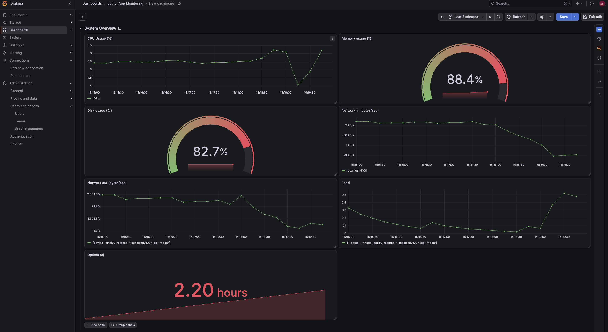
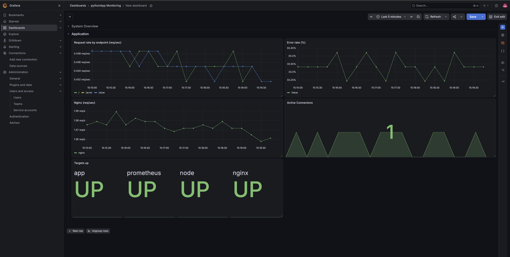
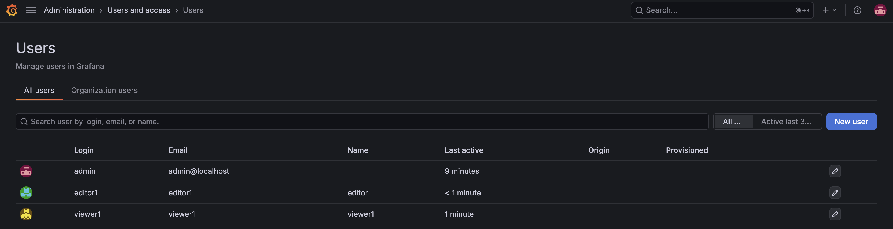
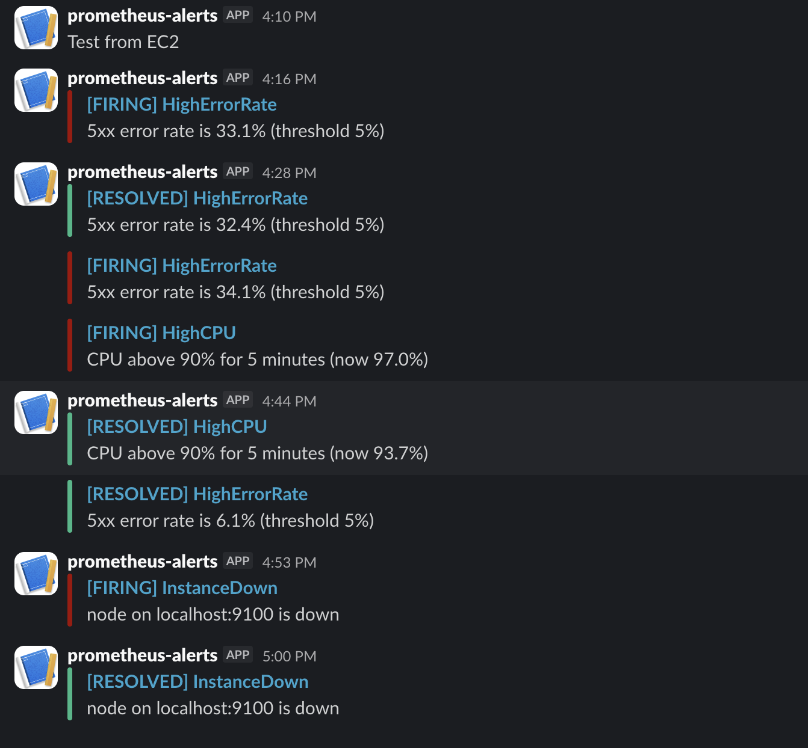

# Server Monitoring with Prometheus & Grafana

A hands-on monitoring stack for a Python web app running on **AWS EC2**. Prometheus collects system, Nginx and custom application metrics, Grafana visualizes them, and Alertmanager sends alerts to **Slack**.

Everything is installed **natively with systemd** (no Docker) to understand how each component actually runs: users, config files, ports, and services.

## Architecture

```
                 ┌────────────────────────── EC2 (Ubuntu) ───────────────────────────┐
                 │                                                                   │
 Browser ──80──► │  Nginx ──► Gunicorn + Flask app (/, /slow, /error, /metrics)      │
                 │    │                       │                                      │
                 │  stub_status           app metrics                                │
                 │    │                       │                                      │
                 │  nginx-exporter     node_exporter                                 │
                 │      :9113              :9100                                     │
                 │         └────────┬────────┘                                       │
                 │                  ▼                                                │
                 │            Prometheus :9090 ──alerts──► Alertmanager :9093 ──► Slack
                 │                  │                                                │
                 │                  ▼                                                │
 Browser ─3000─► │              Grafana :3000                                        │
                 └───────────────────────────────────────────────────────────────────┘
```

## What is monitored

| Layer | Source | Examples |
|---|---|---|
| System | `node_exporter` | CPU, memory, disk, network in/out, load, uptime |
| Web server | `nginx-prometheus-exporter` | requests/sec, active connections, `nginx_up` |
| Application | `prometheus_client` in the Flask app | request counter by endpoint/status, latency histogram (p95) |
| Monitoring itself | Prometheus, Alertmanager | `up` for every target |

## Tech stack

AWS EC2 (Ubuntu) · Nginx · Python / Flask / Gunicorn · Prometheus · node_exporter · nginx-prometheus-exporter · Alertmanager · Grafana · Slack · systemd

## Repository structure

```
.
├── app/                  # Flask app with Prometheus instrumentation, requirements.txt
├── nginx/                # site config + stub_status config
├── prometheus/           # prometheus.yml, alert_rules.yml
├── alertmanager/         # alertmanager.yml (secrets kept out via *_file options)
├── grafana/dashboards/   # exported dashboard JSON
├── systemd/              # unit files for app and every exporter/service
└── docs/screenshots/
```

## Dashboards

One Grafana dashboard, **pythonApp Monitoring**, split into two rows.

**System Overview**: CPU, memory, disk, network in/out, load, uptime



**Application**: request rate per endpoint, error rate %, Nginx requests/sec, active connections, targets up



Panels were built by hand with PromQL, for example:

```promql
# CPU usage %
100 - (avg(rate(node_cpu_seconds_total{mode="idle"}[5m])) * 100)

# Error rate %
100 * sum(rate(app_http_requests_total{status=~"5.."}[5m]))
    / sum(rate(app_http_requests_total[5m]))

# p95 latency
histogram_quantile(0.95, sum by (le) (rate(app_request_duration_seconds_bucket[5m])))
```

## Grafana access control

Sign-up is disabled and anonymous access is off. Three users with different roles: `admin` (Admin), `editor1` (Editor), `viewer1` (Viewer, read-only).



## Alerting

Prometheus evaluates the rules in `prometheus/alert_rules.yml` and sends firing alerts to Alertmanager, which posts to a Slack channel via an incoming webhook (with resolved notifications).

| Alert | Condition | For | Severity |
|---|---|---|---|
| InstanceDown | `up == 0` | 1m | critical |
| HighCPU | CPU > 90% | 5m | warning |
| HighMemory | memory > 90% | 5m | warning |
| DiskAlmostFull | root disk > 85% | 5m | warning |
| HighErrorRate | 5xx responses > 5% of requests | 2m | critical |
| HighLatencyP95 | p95 latency > 1.5s | 2m | warning |
| NginxDown | `nginx_up == 0` | 1m | critical |

### Alerts in action

I tested the pipeline end to end with real failures:

- **HighErrorRate**: sent sustained traffic to `/error`. It fired at 4:16 PM at 33% errors and resolved at 4:28 PM.
- **HighCPU**: pushed CPU past 90%. It fired (97%) and resolved at 4:44 PM.
- **InstanceDown**: stopped `node_exporter`. It fired at 4:53 PM and resolved at 5:00 PM after restarting the service.



## Setup (summary)

1. **EC2**: Ubuntu, `t3.small` or larger. Security group: SSH, Grafana (3000) and Prometheus (9090) from my IP only, HTTP (80) open. Exporter ports stay closed since everything runs on one host.
2. **App**: Flask app under Gunicorn (`1 worker + threads`) as a systemd service, proxied by Nginx.
3. **node_exporter** and **Prometheus** installed from release tarballs, each with its own system user and systemd unit (15s scrape interval, 15d retention).
4. **Nginx exporter**: enable `stub_status` on `127.0.0.1:8080`, run the exporter on `127.0.0.1:9113`.
5. **App metrics**: `prometheus_client` counter and histogram, exposed on `/metrics` (blocked at Nginx so it isn't public).
6. **Grafana** from the official apt repo, Prometheus added as a data source at `http://localhost:9090`.
7. **Alertmanager** with Slack webhook stored in a file (`api_url_file`), wired into Prometheus via `rule_files` and `alerting`.

Validate configs before restarting services:

```bash
promtool check config /etc/prometheus/prometheus.yml
promtool check rules  /etc/prometheus/alert_rules.yml
amtool check-config   /etc/alertmanager/alertmanager.yml
```

## Security notes

- Exporters (`9100`, `9113`) and Alertmanager (`9093`) bind to `127.0.0.1` only.
- Grafana and Prometheus ports are restricted to my IP in the security group.
- The Slack webhook is never committed: Alertmanager reads it from a root-protected file (`chmod 600`).
- Every service runs as its own non-login system user.
- `/metrics` on the app is hidden from the public Nginx site.

## Challenges and learnings

- **Multiple Gunicorn workers break Prometheus counters.** Each worker keeps its own in-memory counters, so scraped values jump around depending on which worker answers. Fixed by running one worker with threads.
- **Label cardinality.** Using the raw URL path as a label creates a new time series for every unique URL (including random 404s). I labelled by Flask's route pattern instead.
- **systemd `203/EXEC` errors.** The service pointed to `/home/ubuntu/app/venv`, but I had built the app as `root`. Rebuilding the app and venv as the `ubuntu` user fixed it.
- **Keeping secrets out of Git.** `api_url_file` lets `alertmanager.yml` be committed safely.
- **Alert design.** Using `for:` durations avoids noisy flapping alerts, and `send_resolved` makes incidents easy to follow in Slack.

## Possible improvements

- Recording rules for expensive queries (e.g. p95 latency)
- Loki + Promtail for log aggregation, correlated with metrics in Grafana
- EC2 service discovery for multi-instance setups
- HTTPS (reverse proxy) in front of Grafana
- A Docker Compose version of the same stack for comparison

## Author

Built by **kT** as a hands-on DevOps project. Feedback welcome.
